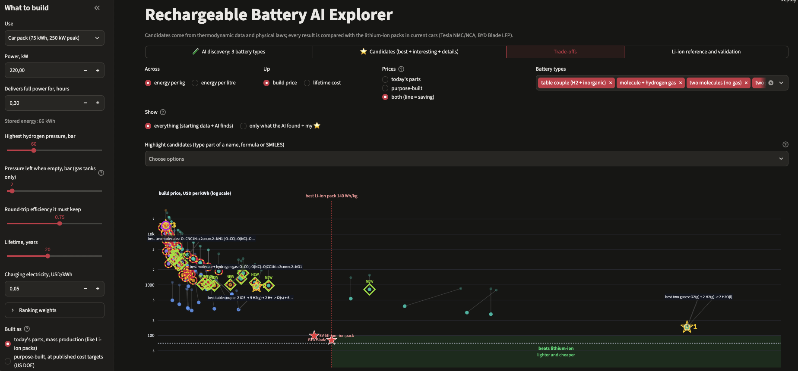

# Rechargeable Battery AI Explorer

Discover, screen and simulate battery chemistries at the whole-system level.

An AI research tool for discovering, screening and comparing rechargeable battery
chemistries across several cell architectures: hydrogen-electrode cells,
molecular batteries with or without hydrogen gas, and sealed two-gas batteries.

The goal is to discover rechargeable batteries that outperform lithium-ion
in energy density, cost and efficiency at the whole-system level.

The central question is: **can a promising chemical reaction become a practical
battery once the mass, cost and losses of the whole system are counted?**
Candidates are generated from thermodynamic data and molecular structures,
then evaluated for voltage, energy density, efficiency, rechargeability, safety
and cost. An AI search (genetic algorithm + machine-learning surrogate + quantum
chemistry) proposes new molecules. The simulator sizes candidates for stationary
storage or car packs and compares them with lithium-ion reference packs.

## Battery types covered

| Family | What stores and releases energy | How candidates are found |
|---|---|---|
| **Hydrogen-electrode cells** | A redox couple paired with an acidic or alkaline hydrogen electrode | Compatible half-reactions from the standard potential table; a Materials Project extension is implemented but has not yet been run |
| **Molecule + hydrogen** | A dissolved redox-active molecule paired with hydrogen gas | Molecular hydrogen-addition partners, quantum-chemistry calculations and AI discovery |
| **Two molecules, no gas** | Two dissolved redox-active molecules exchanging protons and electrons, with no hydrogen-gas storage | Pairing molecules from the computed library and searching for better partners |
| **Two gases, sealed** | A fuel and an oxidant stored in a closed system, with products retained for recharging | Enumeration of small molecules and gas reaction couples, plus AI discovery of larger molecules |

These are candidate rechargeable systems, not a catalogue of proven batteries:
favourable thermodynamics alone does not establish that a reaction can be cycled
reversibly. The molecular and sealed-gas models focus on aqueous acidic cells;
this is not a general simulator for every battery chemistry. Lithium-ion is a
comparison baseline, not a chemistry generated by the search.



*Trade-offs tab: every candidate of every battery type, sized as a whole battery
for a 66 kWh car pack (220 kW × 0.30 h). Build price (USD/kWh, log scale) against energy per kg;
red stars are today's lithium-ion packs, the green zone is lighter and cheaper
than them.*

## Status and findings

The project is paused and published as is. Results depend on the battery family,
the chosen power and duration, and the model's assumptions:

- **No overall replacement for lithium-ion has been demonstrated.** The
  molecule + hydrogen results reach tens of Wh/kg and cost from about
  $1,000/kWh upwards. Sealed-gas simulations can exceed the Li-ion reference
  in Wh/kg, but bring efficiency, cost and rechargeability trade-offs; see the
  dated [gas-battery results and limitations](docs/gas_batteries.md).
- **Whole-system sizing changes the ranking.** High energy per kg of active
  chemical does not guarantee a light or cheap battery. Stack area, electrolyte,
  storage vessels and auxiliary equipment matter; hydrogen architectures also
  carry hydrogen-storage and catalyst costs. Gas-free molecular pairs have a
  different balance of costs and constraints.
- **Aqueous stability constrains charging.** The model uses a water-oxidation
  limit of 1.229 V plus an assumed 0.4 V margin for the positive electrode.
  Near that limit, little headroom remains for charging losses, which can force
  very low current and a large stack. Two-molecule cells must respect the water
  window at both electrodes.
- **Fast and accurate quantum chemistry disagree outside known chemistry** (see
  below): every promising molecule should be checked with DFT, and in the end
  measured (cyclic voltammetry), before it is trusted.

What may be most useful to others: the screening and system-sizing tool, the
library of computed molecules (several hundred, many never reported in PubChem),
and the xTB / DFT / CCSD(T) error comparison.

## Accuracy: xTB vs DFT

The AI search ranks molecules with GFN2-xTB (seconds per molecule); any molecule
can be recomputed in the background with DFT (wB97X-V/def2-TZVP, 10-30 min).
Errors against measured values (`scripts/validate_abinitio.py`,
[docs/validation_abinitio.md](docs/validation_abinitio.md)):

| Test | GFN2-xTB | DFT wB97X-V | CCSD(T) |
|---|---|---|---|
| Gas reactions, cell voltage, 33 molecules (mean / worst) | 0.62 / 2.1 V | 0.10 / 0.18 V | 0.06 / 0.16 V |
| Energy of formation, test half, 22 molecules (mean) | 106 kJ/mol | 14 kJ/mol | 11 kJ/mol |
| Quinone voltages in water, no fitted constant | 0.4-0.6 V high | 0.02-0.14 V | - |

The search corrects xTB with one constant fitted on known quinones, which makes
it accurate for quinone-like molecules only (test error ~0.01 V on 3 quinones).
On other chemistry the two methods can differ by 0.5-0.9 V: trust DFT, and treat
xTB as a ranking tool.

## What it does

| Stage | Method | State |
|---|---|---|
| 1. Generate | hydrogen couples from compatible standard-table half-reactions; molecule + H2 candidates and gas-free molecular pairs; sealed fuel/oxidant gas cells; Materials Project reactions `A + x H2 -> B + y H2O` and `M + x H2 -> MH2x` | table, molecules, pairs and gases: implemented; MP: needs `MP_API_KEY` (code written, not yet run) |
| 2. Voltage, energy | E0, Nernst term with real H2 fugacity, Wh/kg of reactants | works |
| 3. Real gas | CoolProp equations of state: density, fugacity, condensation (Cl2 is liquid above ~7 bar) | works |
| 4. Stability | water oxidation above 1.229 V + margin; radioactive elements excluded; products that are very hard to turn back (N2, CO2, ...) flagged | works (Pourbaix check through MP: to do) |
| 5. New compounds | universal ML interatomic potentials (CHGNet / MACE-MP) on ion-substituted solids | to do (molecules: see below) |
| 6. Safety, cost | element prices and supply concentration (pymatgen data), PubChem GHS hazards (`--ghs`) | works |
| 7. Efficiency, power, recharge | Butler-Volmer kinetics, ohmic gap/conductivity, Fick's law with Stokes-Einstein diffusion and Henry's-law gas supply; Monte Carlo over the unknown inputs, p10/p50/p90, and the input that dominates | works |
| 7b. Weight vs pressure | gas swing volume from real-gas density, thin-wall vessel mass `phi rho p V / sigma`, stack, catalyst; sweep of maximum pressure | works |
| 8. Lifetime | no law predicts it | reported as unknown |
| Safety vs pressure | isentropic burst energy (kg TNT), choked-flow leak, time to 25 % of the H2 flammability limit, p x V | works |
| Maintenance | H2 permeation (316L Arrhenius fits from h-transport-materials, Sieverts' law) and seal leaks; chemical closure from measured and derived (Latimer) half-reactions: over-reduction, disproportionation, O2 recombination | works |
| Design | power x duration sizing, current density chosen for the lowest levelised cost, Pareto front | works |
| Molecules | any molecule: H2-addition partners, xTB/ALPB voltages calibrated on p-benzoquinone (+/-0.3 V), tautomer check, ESOL solubility, SA score, PubChem novelty; AI search loop | works |

How every part works (simulation, AI search, prices and their sources,
limits): [docs/approach.md](docs/approach.md). The sealed-gas search and its
specific limitations are described in [docs/gas_batteries.md](docs/gas_batteries.md).

Results that rest on assumptions say so: each input is tagged `database`,
`physics`, `assumption` or `unknown`, and every range is in `targets.toml`.

## Install

Python 3.12, with [uv](https://docs.astral.sh/uv/):

```bash
uv venv --python 3.12 .venv
uv pip install --python .venv/bin/python -r requirements.txt
./setup_accurate.command        # optional: PySCF, for the DFT checks
```

## Visual simulator

```bash
.venv/bin/streamlit run app.py
```

Open http://localhost:8501. In any molecule's details: recompute it with DFT in
the background, switch every number between the xTB and DFT voltage, tag it and
give it a colour (shown on every chart), or add it to your candidates.

Sidebar: what to build (stationary or car pack preset, power, duration,
pressure limits, efficiency target, lifetime, electricity price, ranking
weights). Tabs:

- **Trade-offs**: energy per kg vs build cost (Pareto front, Li-ion lines),
  safety vs cost, energy per kg vs pressure.
- **⭐ Candidates**: first, the best candidates of every battery type in one
  table (table couples, molecule + H2, two molecules, sealed gases), each
  sized as a whole battery, with today's and purpose-built prices and what it
  beats lithium-ion on; the table couples' full detail (pressure, burst energy,
  leak rate, H2 refill interval, chemical drift) is in an expander. Then your
  interesting candidates of every kind
  (couples, molecules, pairs, sealed gas cells), recalculated with the
  settings, with total and per-kWh build price and a one-setting sweep; below,
  the details of any candidate: mass, volume, cost, LCOS, burst energy, leak,
  H2 loss and efficiency against pressure; power vs duration; efficiency vs
  current; mass breakdown; maintenance and closure; every input with its
  provenance; for gas cells, 350 vs 700 bar tanks and where the money goes.
- **AI discovery: 3 battery types** (pick one at the top of the tab):
  molecule + hydrogen gas, two molecules (no gas), and two gases (sealed).
  Each has the same AI loop: genetic generator (SELFIES) + surrogate model +
  GFN2-xTB; the gas search starts from every molecule up to 4 heavy atoms
  and proposes larger ones.
- **Li-ion reference and validation**: Tesla 4680/2170, BYD Blade, pack
  prices (BloombergNEF 2025) with sources, and the model checks.

## Command line

The CLI below runs the hydrogen-couple screen and its validation. Use the
Streamlit app for the three AI discovery modes and comparisons across families.

```bash
.venv/bin/python -m h2screener run --top 30          # out/report.md, out/candidates.csv
MP_API_KEY=... .venv/bin/python -m h2screener run --mp all
.venv/bin/python -m h2screener validate             # model priors vs published cells
.venv/bin/python -m pytest -q tests
```

`data/standard_potentials.csv` is rebuilt from the downloaded table with
`scripts/parse_potentials.py`; the source page and revision are recorded there.

## Validation

Published hydrogen-cell measurements check whether the physics and the assumed
ranges cover reality; they are not used to fit that screen:

- Mn-H2 (Chen et al., Nature Energy 3 (2018) 428), ~1.3 V measured: model OCV 1.22 V (inside the check).
- H2-Br2 (Cho et al., J. Electrochem. Soc. 159 (2012) A1806), 1.4 W/cm2 peak measured:
  model p90 is 0.72 W/cm2 (outside). The generic range for the reaction speed of
  an untested electrode is too pessimistic for fast halogen couples. This is the
  input a kinetics model (stage 5 descriptors / ML) has to supply.

Molecular voltages and pairs have separate
[known-molecule benchmarks](docs/benchmark_known.md), and the quantum-chemistry
methods have [accuracy checks](docs/validation_abinitio.md). These checks do not
establish cycle life or experimental rechargeability for newly proposed cells.

## Next

1. Materials Project generator (`--mp`), then MP Pourbaix stability for every candidate.
2. Per-couple kinetics estimates instead of one wide prior: Marcus reorganisation
   energies from xTB for molecular couples, and a regression of measured exchange
   currents on element/structure descriptors, with symbolic regression (PySR) to
   look for simple predictive equations. Found equations are hypotheses until
   they predict held-out measurements.
3. New compounds: substitution of ions in known hydrogen hosts, relaxed with a
   universal ML potential, kept when within 50 meV/atom of the MP hull.
4. Active learning: choose the next candidate to compute where the expected
   gain in score is largest.

## Author

Nassim MOUALEK (nmoualek@gmail.com)

## License

The code is released under the [MIT License](LICENSE). Third-party data keeps
its own licence: the standard potential table from Wikipedia
(`data/raw/potentials.wikitext` and `data/standard_potentials.csv`, CC BY-SA 4.0)
and ML-HYDPARK (`data/raw/hydpark/`, Witman et al., Sandia National Laboratories,
CC BY 4.0). Sources and revisions are recorded in each `SOURCE.txt`.
